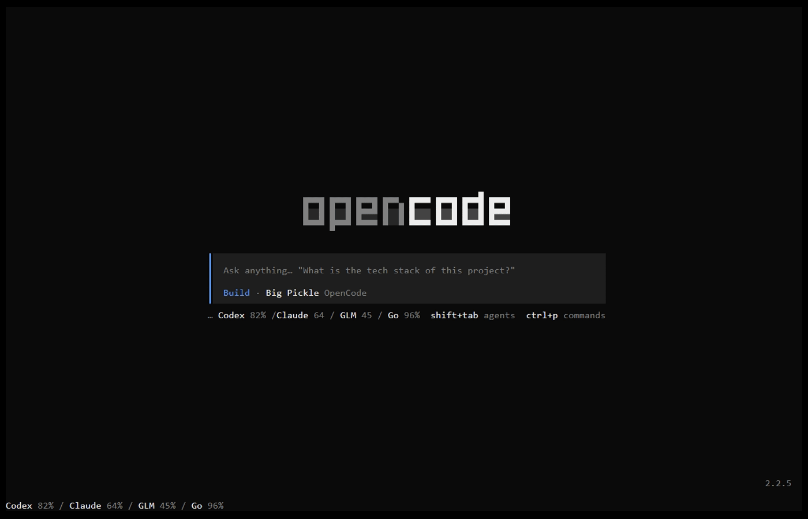

# opencode-usage

A plugin for the [OpenCode](https://opencode.ai) TUI (v2) that shows how much of your **Codex**, **Claude**,
**GLM Coding Plan** and **OpenCode Go** quota is left: a card in the session sidebar, a one-liner in the prompt
footer and on the home screen, and a `/usage` command.

> Supports OpenCode V2 only, 2.2.5 or newer. V1 is not supported.

<p align="center">
  
</p>

The demo shows, in order: the usage line in the footer, `/usage` with its summary toast, and the sidebar card
with two Claude accounts once a session is open. All numbers are made up.

## Features

- **Sidebar card** with a bar per quota window (`5h`, `7d`, `1m`), the percentage **remaining** and the time
  until it resets. Bars turn yellow at 50% and red at 20% remaining.
- **Prompt footer and home screen line** with the 5-hour window of every provider, e.g. `Codex 82% / Claude 64%`.
- **`/usage`** (slash command and palette) refreshes everything and shows a summary toast.
- **Several Claude accounts.** Every Claude account connected in OpenCode gets its own rows and a masked email.
  With the Claude Agent integration connected, the plugin shows the Claude Code login instead.
- **Only what you use.** Providers without credentials are hidden; you can switch off the rest in the options.
- **Gentle on the APIs.** Rate limits (`429`) start a cooldown that is shared by every open TUI window, and
  a transient error keeps the last good numbers on screen. Claude is fetched after each turn and otherwise
  every 2 → 4 → 8 → 15 minutes.

## Requirements

- OpenCode V2 2.2.5 or newer.
- An account with at least one of the providers:

| Provider | Where the plugin finds your login |
|---|---|
| Codex | `codex login` (`$CODEX_HOME/auth.json`, default `~/.codex`), or ChatGPT connected in OpenCode (`/connect`) |
| Claude | Claude accounts connected in OpenCode by an Anthropic auth plugin, or the Claude Code login when the Claude Agent integration is connected (`~/.claude/.credentials.json`, the macOS Keychain, `CLAUDE_CONFIG_DIR` respected). Needs a Pro or Max subscription. |
| GLM Coding Plan | Z.AI or Zhipu Coding Plan connected in OpenCode, or `ZAI_API_KEY` / `ZHIPU_API_KEY` |
| OpenCode Go | The `goApiKey` option, `OPENCODE_API_KEY`, or an OpenCode API key connected in OpenCode |

## Install

Install the plugin from GitHub with the OpenCode CLI. Pin a release tag, so the install is cached and
`opencode plugin update` can tell when a new version is out:

```sh
opencode plugin add github:igorovh/opencode-usage#v0.3.0
```

This adds the plugin to the `plugins` array in `~/.config/opencode/cli.json`. Restart the TUI and the card
appears in the session sidebar.

Update or remove it later:

```sh
opencode plugin update github:igorovh/opencode-usage
opencode plugin remove github:igorovh/opencode-usage
```

### Upgrading from `opencode2-usage`

The plugin used to be called `opencode2-usage` and was added to `opencode.jsonc`. Remove that entry and
install it again as shown above. Your cached usage data is kept.

## Options

Options go in **`~/.config/opencode/cli.json`**, in an object entry whose `package` is exactly the string you
installed. `opencode plugin add` does not write options for you, and options in `opencode.jsonc` never reach
the TUI.

```jsonc
{
  "plugins": [
    {
      "package": "github:igorovh/opencode-usage#v0.3.0",
      "options": {
        "providers": { "glm": false, "opencode-go": false },
        "footer": false
      }
    }
  ]
}
```

| Option | Default | Description |
|---|---|---|
| `providers` | all `true` | Turn providers off, e.g. `{ "codex": false }`. Ids: `codex`, `claude`, `glm`, `opencode-go`. |
| `sidebar` | `true` | Show the sidebar card |
| `footer` | `true` | Show the prompt footer line |
| `home` | `true` | Show the home screen line |
| `refreshMs` | `60000` | How often Codex, GLM and Go are refreshed, in ms (minimum `15000`) |
| `goApiKey` | auto | OpenCode Go API key (`apiKey` works too) |
| `goBaseUrl` | `https://opencode.ai/zen/go` | OpenCode Go API base; must be `https` except for localhost |
| `claudeUserAgent` | `claude-code/2.1.0` | User agent sent to the Claude usage endpoint |
| `log` | `false` | Write a JSONL log of every API call to `<data>/log/usage-plugin.log` (1 MB, then rotated) |

## How it works

The plugin runs only in the TUI. It reads credentials through OpenCode's credential API, never writes them, and
sends each token only to its own provider:

| Provider | Endpoint |
|---|---|
| Codex | `chatgpt.com/backend-api/wham/usage` |
| Claude | `api.anthropic.com/api/oauth/usage` |
| GLM | `api.z.ai` or `bigmodel.cn` `/api/monitor/usage/quota/limit` (picked from where the key was found) |
| OpenCode Go | `opencode.ai/zen/go/v1/usage` |

None of these endpoints are documented, so they can change without notice. The Claude endpoint throttles
unknown clients, which is why the default user agent looks like Claude Code.

The last numbers and any rate-limit cooldown are kept in the plugin's storage, so they survive restarts and are
shared between TUI windows.

The package ships a precompiled `dist/tui.js`: OpenCode does not apply the Solid transform to plugins installed
under `node_modules` ([anomalyco/opencode#39986](https://github.com/anomalyco/opencode/issues/39986)).

## Development

Requires [Bun](https://bun.sh).

```sh
git clone https://github.com/igorovh/opencode-usage.git
cd opencode-usage
bun install
bun run typecheck
bun test
bun run check:usage   # print your usage from the command line, without the TUI
```

To run your checkout instead of the published plugin, put its path in `cli.json` and restart the TUI. A local
folder loads `tui.ts` straight from `src/`, and OpenCode reloads it when a file changes.

```jsonc
{
  "plugins": ["/path/to/opencode-usage"]
}
```

Run `bun run compile` before you commit a change to `src/`; CI fails when `dist/` is out of date.

The README demo is recorded with [VHS](https://github.com/charmbracelet/vhs): `vhs docs/demo.tape`. It runs
OpenCode in a throwaway profile, and `OPENCODE_USAGE_FIXTURE` points the plugin at `docs/demo-fixture.json`
instead of the real APIs.

## Credits

- [slkiser/opencode-quota](https://github.com/slkiser/opencode-quota) for the Codex usage parsing.
- [steipete/codexbar](https://github.com/steipete/codexbar) for the Claude user agent trick.

## License

[MIT](LICENSE)
